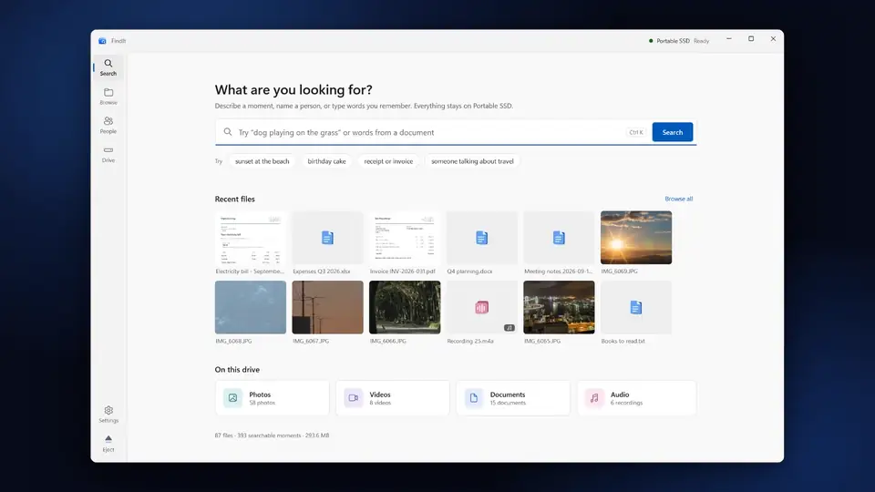

<p align="center">
  
</p>

<h1 align="center">FindIt</h1>

<p align="center">
  <strong>Offline search for photos, videos, audio and documents, carried on the drive itself.</strong>
</p>

<p align="center">
  <a href="https://github.com/adilzubair/FindIt/actions/workflows/ci.yml"></a>
  <a href="https://github.com/adilzubair/FindIt/releases"></a>
  <a href="LICENSE"></a>
  
</p>

<p align="center">
  <a href="docs/media/findit-demo.mp4"></a>
  <br />
  <sub>A 38-second tour of the real app. <a href="docs/media/findit-demo.mp4">Watch it with sound</a> · <a href="docs/media/CREDITS.md">media credits</a></sub>
</p>

Prepare an external drive once on a capable Windows PC. Then plug it into any other Windows PC and search everything on it — by filename, by the exact words inside a document, or by meaning ("red bicycle in a forest", "someone speaking about invoices") — with no installation, no internet connection and no cloud account.

The application, AI models, previews, search index and people data all live on the drive next to your files. Your originals stay exactly where they are and are only ever read.

> [!IMPORTANT]
> FindIt is a **development preview**. It works end to end and is covered by over 200 automated tests and physical-drive checks, but it has not yet passed its public-release gates (clean-machine testing, one-million-file scale on an 8 GB laptop, signed packages). See [validation status](docs/validation.md).

## Features

- **Search by meaning** across images, video frames, video scenes, speech, sound and document text, using a local [EmbeddingGemma](https://huggingface.co/ggml-org/embeddinggemma-2-GGUF) model, combined with exact keyword search (SQLite FTS5).
- **Video moments**: results open at the matching moment, with scene-aware sampling, a timeline of matches and transcripts from Whisper.
- **Documents**: PDF (with OCR for scanned pages), Office Open XML, RTF, HTML and plain text, with the matching words highlighted.
- **People**: faces are grouped locally; name a group or enroll a reference photo, review suggested matches, then search for one or several people together.
- **Filters** by type, folder, date and person.
- **Truly portable**: a self-contained package with its own .NET runtime, codecs and models. Nothing to install on the host PC.
- **Safe with your files**: originals are never modified, moved or uploaded. Preparation is resumable, crash-safe and keeps the previous complete index if anything fails.
- **Private by design**: no telemetry, no accounts and no background network access. Update checks only happen when you ask and when a publisher has been configured.

## Getting started

### Requirements

- Windows 10 22H2 or Windows 11, x64
- An external drive (USB stick, SSD or HDD; NTFS, exFAT or FAT32) with room for the package (~2 GB) plus the index
- A reasonably fast PC for the first preparation; searching works on modest hardware

### Install

1. Download `FindIt-<version>-win-x64.zip` from the [latest release](https://github.com/adilzubair/FindIt/releases) and verify it against the published `.sha256` file.
2. Extract it to the **root** of your external drive, so the drive contains `FindIt.exe` and a `FindIt` folder side by side. Leave your existing folders where they are.

### Use

1. Open `FindIt.exe` on the drive. A small startup window appears while the app is copied into a local cache on first launch.
2. Go to **Drive**, choose the folders to make searchable and the OCR languages, then start preparation. Large libraries can take hours; you can pause and resume, and partial results become searchable along the way.
3. Search from the home screen. Select a result to preview it; videos and recordings open at the matching moment.
4. In **People**, name face groups or add a reference photo, and confirm or reject suggested matches.
5. Use **Eject** before unplugging the drive. On the next PC, just open the same `FindIt.exe`.

> [!NOTE]
> Person and action results are *possible matches* based on sampled frames. Review them before relying on someone's identity.

### What FindIt stores on the host PC

Only disposable caches under `%LOCALAPPDATA%\FindIt`, which can be deleted whenever FindIt is closed:

| Folder | Contents |
|---|---|
| `runtime` | A copy of the application binaries, so the app survives drive removal and the drive can be ejected cleanly |
| `verification` | Which model files were already checksum-verified, to skip re-reading them on later launches |
| `instances` | Tiny process records so repeated clicks bring the open window forward (no filenames or content) |

Models, indexes, extracted text, people data, recent searches and preferences stay on the drive.

### Updating a prepared drive

Close FindIt, then copy the new `FindIt.exe` and `FindIt` folder over the old ones, keeping `FindIt/archive` and your original folders. The existing library opens immediately; run preparation again when you want new extraction improvements applied to it.

## How it works

```text
FindIt.exe (native launcher)
   └─ FindIt.App (WPF UI)
        ├─ Worker: reader     search, previews, people       ─┐
        ├─ Worker: preparer   extraction, embeddings, faces   ├─ framed JSON-RPC over pipes
        └─ Worker: preview    isolated LibVLC playback       ─┘
```

Heavy and native work runs in separate worker processes, so a crashing decoder cannot take down the UI. Preparation writes immutable, checksummed index generations and only switches to a new one when it is complete. Read [architecture](docs/architecture.md) for the full design.

## Building from source

Requires Windows x64, [.NET SDK 10.0.400](https://dotnet.microsoft.com/download) and PowerShell 7.2+. The build downloads its own compiler, CMake, pinned native sources and models (all SHA-256 verified); Visual Studio is not needed.

```powershell
./scripts/Build.ps1                              # dependencies, native and managed build, tests
./scripts/Publish-Portable.ps1 -SkipBuild -Zip   # artifacts/portable and artifacts/portable.zip
```

See [development](docs/development.md) for the managed-only workflow, test harnesses, validation tools and the release process.

## Documentation

- [Architecture](docs/architecture.md): processes, storage, retrieval and people
- [Validation status](docs/validation.md): what has been measured, release gates and known limits
- [Development](docs/development.md): building, testing, releasing
- [People evidence and media timing](docs/people-evidence.md)
- [Scale benchmark](docs/scale-benchmark.md), [recovery validation](docs/recovery-validation.md), [drive validation](docs/drive-validation.md)
- [Changelog](CHANGELOG.md)

## Contributing

Bug reports, ideas and pull requests are welcome. Please read [CONTRIBUTING.md](CONTRIBUTING.md) first, and report security issues privately as described in [SECURITY.md](SECURITY.md).

## License

FindIt is released under the [MIT License](LICENSE).

The portable package bundles third-party software and models under their own licenses, including LGPL-licensed FFmpeg and LibVLC, which ship as separate, replaceable libraries. See [THIRD-PARTY-NOTICES.md](THIRD-PARTY-NOTICES.md) and the `licenses` folder in each package.

## Acknowledgements

FindIt builds on [llama.cpp](https://github.com/ggml-org/llama.cpp), [EmbeddingGemma](https://huggingface.co/ggml-org/embeddinggemma-2-GGUF), [USearch](https://github.com/unum-cloud/USearch), [whisper.cpp](https://github.com/ggml-org/whisper.cpp), [OpenCV](https://github.com/opencv/opencv) and the YuNet/SFace models, [Tesseract](https://github.com/tesseract-ocr/tesseract), [PDFium](https://pdfium.googlesource.com/pdfium/), [FFmpeg](https://ffmpeg.org/), [LibVLC](https://www.videolan.org/vlc/libvlc.html) and [SQLite](https://sqlite.org/). [DigUp](https://github.com/ARahim3/DigUp) informed the early architecture and model compatibility work.
